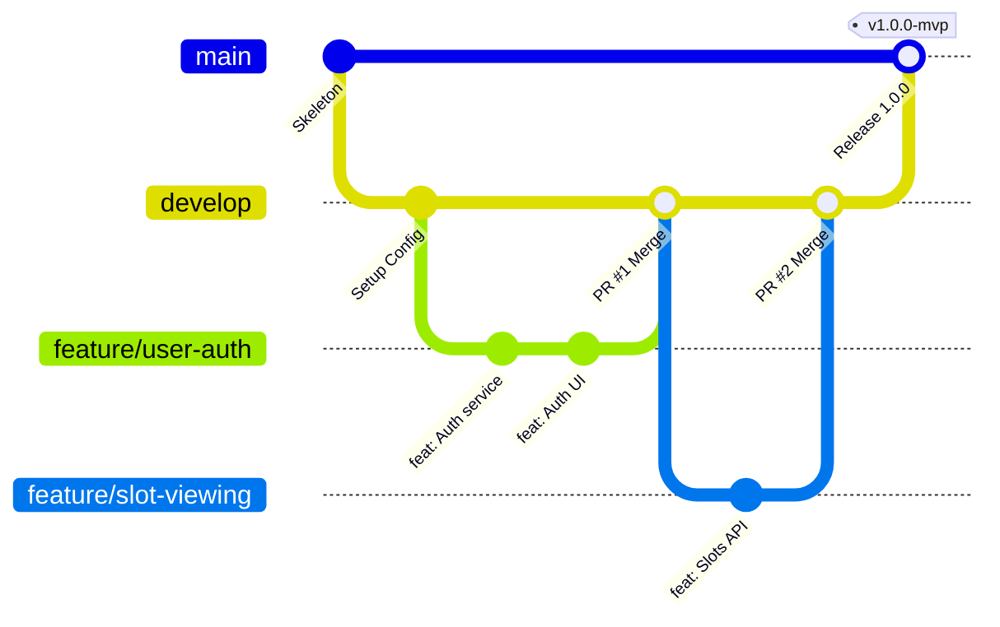

# Containerized E-Notary Appointment System

[](https://adoptium.net/)
[](https://spring.io/projects/spring-boot)
[](https://maven.apache.org/)
[]()

> A robust, containerized web application for scheduling, confirming, and tracking legal notarial appointments, developed as part of the DevOps Engineering Coursework.

---

## 👨‍💻 Project Identity

* **Developer:** Aryan Racha
* **Roll Number:** `23102C0055` (Entry #39)
* **Coursework Reference:** `docs/devops-project-guidelines.ods`

---

## 🚀 Key Functional Features (6 MVP Modules)

1. **User Registration & Authentication:** Secure registration and login for Clients and Notaries with role-based access.
2. **Availability & Slot Viewing:** Interactive calendar/grid showing available 30-minute appointment slots for certified notaries.
3. **Booking Request Submission:** Self-service booking with document classification (*Affidavit*, *Deed*, *Power of Attorney*) and instant alphanumeric reference code generation.
4. **Notary Confirmation Dashboard:** Notaries can inspect pending requests and confirm or decline them.
5. **Cancellation & Slot Release:** Clients or notaries can cancel appointments with mandatory reason tracking, instantly releasing the time slot back into availability.
6. **Public Status Tracking:** Fast, unauthenticated lookup page allowing applicants to track appointment progress using their reference code (`ENOT-YYYY-XXXX`).

---

## 🛠️ Technology Stack

| Component | Technology | Rationale |
| :--- | :--- | :--- |
| **Backend Framework** | **Java 17 + Spring Boot 3** | Robust enterprise standard; native support for embedded/standalone Tomcat. |
| **Build & Dependency Management** | **Apache Maven** | Lifecycle management (`compile`, `test`, `package`) mandated for Jenkins and Selenium. |
| **Frontend UI** | **Thymeleaf + Bootstrap 5** | Server-Side Rendering (SSR) ensures reliable, deterministic Selenium WebDriver E2E test runs. |
| **Database** | **H2 (Dev/Test) + PostgreSQL (Prod)** | Fast in-memory database for local/CI tests; PostgreSQL for persistent containerized deployment. |
| **Continuous Integration** | **Jenkins Declarative Pipeline** | Automated checkout, build, artifact archival, and test gates via `Jenkinsfile`. |
| **Automated Testing** | **Selenium WebDriver + JUnit 5** | End-to-end browser automation executing directly through Maven. |
| **Containerization** | **Docker** | Multi-stage build producing lightweight, secure production container images. |
| **Configuration Management** | **Ansible** | Declarative YAML playbooks ensuring idempotent server provisioning and rollback. |

---

## 🌿 Git Branching Policy

To guarantee code quality and clear collaboration history, the repository strictly enforces the following branching model:



* **`main`**: Production-ready branch. Only receives merges from `develop` via tagged releases (`v1.0.0-mvp`).
* **`develop`**: Integration branch where all completed features are merged and verified.
* **`feature/<name>`**: Dedicated short-lived branches created from `develop` for specific tasks (e.g., `feature/user-auth`, `feature/booking-request`). Merged via reviewed Pull Requests.
* **`hotfix/<name>`**: Emergency patches branched directly from `main` and merged into both `main` and `develop`.

---

## 📖 Coursework Documentation Roadmap

Progressive step-by-step documentation is maintained under [`docs/`](docs/):

* [`docs/0-init.md`](docs/0-init.md) — Baseline, Stack Evaluation & Agentic Setup
* [`docs/01-problem-definition-and-scope.md`](docs/01-problem-definition-and-scope.md) — Needs Analysis, Stakeholders & 15-Task MVP Scope
* [`docs/02-agile-planning-and-devops-workflow.md`](docs/02-agile-planning-and-devops-workflow.md) — User Stories, Sprint Backlog, DoD & Lifecycle Diagram
* [`docs/03-requirements-architecture-and-setup.md`](docs/03-requirements-architecture-and-setup.md) — SRS, Use Case, Architecture, ER Models & API Spec
* [`docs/04-git-and-github-initialization.md`](docs/04-git-and-github-initialization.md) — Branch Policies, Repo Config & Skeleton
* `docs/05-feature-development-with-branching.md` — Feature 1 Branch, PR & Code Review
* `docs/06-mvp-completion-and-collaboration.md` — 6-Feature MVP, Merge Conflict Resolution & Tagged Release
* `docs/07-jenkins-ci-job.md` — Jenkins CI Job & Maven Artifact Archival
* `docs/08-pipeline-as-code-and-deployment.md` — Declarative `Jenkinsfile` & Tomcat Deployment
* `docs/09-selenium-testing-suite.md` — Selenium E2E Test Suite & Failure Screenshots
* `docs/10-continuous-testing-in-jenkins.md` — Quality Gate & Defect Injection Demonstration
* `docs/11-docker-container-lifecycle.md` — Multi-stage `Dockerfile` & Container Management
* `docs/12-jenkins-docker-continuous-deployment.md` — Automated Docker Hub Pipeline
* `docs/13-ansible-configuration-management.md` — Ansible Server Prerequisites Playbook
* `docs/14-automated-provisioning-and-rollback.md` — Idempotent Node Provisioning & Rollback Demo

---

## ⚡ Getting Started Locally

### Prerequisites
* **Java 17 LTS**
* **Maven 3.9+** (or bundled `./mvnw`)

### Build and Run
```bash
# Clone the repository
git clone <repo-url>
cd devops-project

# Compile the application
./mvnw clean compile

# Run automated tests
./mvnw test

# Package into an executable JAR
./mvnw clean package

# Run the Spring Boot application
./mvnw spring-boot:run
```

Access the application in your browser:
* **Web Portal:** `http://localhost:8080/`
* **H2 Console:** `http://localhost:8080/h2-console`
* **Actuator Health:** `http://localhost:8080/actuator/health`
