# Stage 1: Problem Definition and Scope

| Metadata | Details |
| :--- | :--- |
| **Project Name** | Containerized E-Notary Appointment System |
| **Coursework Reference** | `docs/devops-project-guidelines.ods` (Row 39) |
| **Student** | Aryan Racha (Roll No: `23102C0055`) |
| **Status** | Approved MVP Scope Baseline |

---

## 1. Problem Statement & Real-Time Need

In conventional legal and administrative systems, obtaining notarial services (such as affidavit verification, real-estate deeds, powers of attorney, and statutory declarations) is plagued by manual inefficiencies:
- **Uncoordinated Walk-ins:** Clients arrive at notary offices without knowing if a certified notary is available, leading to hours of waiting in line.
- **Double Booking & Schedule Conflicts:** Paper registers and ad-hoc phone appointments frequently cause overlapping bookings.
- **Lack of Transparency & Status Tracking:** Clients have no mechanism to check if their booking is confirmed, pending notary review, or rescheduled.
- **Disorganized Cancellations:** Manual cancellations fail to release slots in real time, preventing other citizens from utilizing open availability.

The **Containerized E-Notary Appointment System** addresses these pain points by offering an automated, centralized web platform where clients can view live notary schedules, request specific appointment slots, receive instant confirmation references, and manage cancellations.

From an engineering and operational perspective, the application is designed to be **lightweight, containerized, and fully automated** through a modern DevOps toolchain (Maven, Jenkins, Selenium, Docker, and Ansible).

---

## 2. Stakeholder Analysis

| Stakeholder Group | Role | Core Needs & Expectations |
| :--- | :--- | :--- |
| **Clients / Citizens** | Primary End-Users | Quick registration, real-time view of available notary slots, intuitive booking forms, instantaneous reference codes, and self-service cancellation. |
| **Certified Notaries** | Service Providers | Ability to publish availability windows, review appointment requests, accept/confirm or reject bookings, and review daily schedules. |
| **DevOps / SysAdmin** | Platform Operator | Automated continuous integration, reliable container packaging, declarative deployment pipelines, and idempotent configuration management. |
| **Compliance & Auditors** | Oversight Authority | Accurate audit trail of timestamps, unique booking reference identifiers, and status transitions (`REQUESTED` → `CONFIRMED` → `COMPLETED` / `CANCELLED`). |

---

## 3. Project Objectives & Measurable Success Criteria

### Primary Objectives
1. **Digitize the Notary Scheduling Workflow:** Provide full self-service booking, confirmation, and cancellation.
2. **Prevent Slot Collision:** Enforce strict transactional isolation to guarantee zero double bookings for any notary slot.
3. **Automate the DevOps Delivery Cycle:** Implement automated CI/CD pipelines, end-to-end browser testing, containerization, and configuration management.

### Measurable Success Criteria

| Category | Metric | Target |
| :--- | :--- | :--- |
| **Functional** | MVP Feature Coverage | 100% of the 6 core features operational (Registration, Slot View, Booking, Confirmation, Cancellation, Status Tracking). |
| **Reliability** | Double-Booking Prevention | 0% duplicate reservations on identical notary time slots. |
| **CI / Build** | Pipeline Build Time | Automated Maven compile, test, and package completed in < 60 seconds on Jenkins. |
| **Quality Gate** | Test Pass Rate | 100% pass on all Selenium E2E and JUnit regression tests prior to deployment. |
| **Containerization** | Cold Start Time | Application container running and serving traffic within 15 seconds of launch. |
| **Config Management**| Ansible Idempotency | 0 changes (`changed=0`, `failed=0`) on secondary playbook execution. |

---

## 4. Project Constraints

1. **Academic & Technology Stack Constraints:**
   - Programming Language: Java 17.
   - Application Framework: Spring Boot 3 (with embedded Tomcat / WAR option).
   - Build Tool: Apache Maven (`pom.xml`).
   - Testing: Selenium WebDriver executed through Maven.
   - Automation: Jenkins Declarative Pipeline (`Jenkinsfile`) and Ansible configuration playbooks.
2. **Resource Constraints:**
   - Lightweight footprint capable of running cleanly inside local Docker containers with < 512MB heap allocation.
3. **Domain Constraints:**
   - Time slots must be discrete (e.g., 30-minute intervals).
   - Only registered clients can initiate a booking request.
   - Appointments in the past cannot be booked or cancelled.

---

## 5. Frozen 15-Task MVP Scope

To fulfill the syllabus requirement for a structured **15-Task MVP Scope**, the project features are subdivided into 15 atomic engineering tasks:

```mermaid
flowchart LR
    subgraph Epic1["1. Auth & Users"]
        T1["TASK-01<br/>Domain Entities"]
        T2["TASK-02<br/>Repositories"]
        T3["TASK-03<br/>User Registration"]
        T4["TASK-04<br/>Auth UI & Session"]
    end

    subgraph Epic2["2. Availability & Slots"]
        T5["TASK-05<br/>Notary Schedule Config"]
        T6["TASK-06<br/>Slot Browsing View"]
    end

    subgraph Epic3["3. Booking & Concurrency"]
        T7["TASK-07<br/>Booking Form & Payload"]
        T8["TASK-08<br/>Collision Prevention"]
        T9["TASK-09<br/>Reference Generator"]
    end

    subgraph Epic4["4. Management & Tracking"]
        T10["TASK-10<br/>Client Dashboard"]
        T11["TASK-11<br/>Notary Confirmation"]
        T12["TASK-12<br/>Cancellation Workflow"]
        T13["TASK-13<br/>Slot Release Logic"]
        T14["TASK-14<br/>Public Status Tracker"]
    end

    subgraph Epic5["5. Operations & Health"]
        T15["TASK-15<br/>Health Check & Actuator"]
    end

    Epic1 --> Epic2 --> Epic3 --> Epic4 --> Epic5
```

### Detailed Task Specification

| Task ID | Task Title | Feature Group | Description & Acceptance Bound |
| :--- | :--- | :--- | :--- |
| **TASK-01** | Define Domain Entities | Data Modeling | Create `User`, `Role`, `Notary`, `AppointmentSlot`, and `Booking` JPA entities with relationships. |
| **TASK-02** | Implement Data Repositories | Data Access | Setup Spring Data JPA repositories with custom query methods (e.g., `findBySlotDateAndNotaryId`). |
| **TASK-03** | User Registration Logic | Authentication | Service logic to register clients and notaries with input validation and password hashing. |
| **TASK-04** | Auth & Login Interface | User Interface | HTML/Thymeleaf views for login and sign-up with error banner handling. |
| **TASK-05** | Notary Schedule Configuration | Availability | Service and endpoints allowing notaries to define available time slots for upcoming dates. |
| **TASK-06** | Slot Viewing Calendar/Grid | Availability | Interactive calendar/list view showing open slots filtered by notary and date. |
| **TASK-07** | Booking Request Submission | Booking | Form for clients to select an available slot, enter document type (Affidavit, Deed, POA), and submit. |
| **TASK-08** | Concurrency & Collision Check | Booking | Transactional logic ensuring a slot cannot be booked simultaneously by two applicants. |
| **TASK-09** | Reference Code Generation | Confirmation | Generate an alphanumeric booking reference (e.g., `ENOT-2026-XXXX`) upon request submission. |
| **TASK-10** | Client Appointments Dashboard | Management | View for clients displaying their upcoming, completed, and cancelled bookings. |
| **TASK-11** | Notary Decision Dashboard | Confirmation | View for notaries to review incoming booking requests and mark them `CONFIRMED` or `REJECTED`. |
| **TASK-12** | Appointment Cancellation Form | Cancellation | Modal/form allowing client or notary to cancel an appointment with a mandatory cancellation reason. |
| **TASK-13** | Slot Re-activation Engine | Cancellation | Automated logic that flips slot status back to `AVAILABLE` when an appointment is cancelled. |
| **TASK-14** | Public Status Tracking Page | Tracking | Lookup view allowing anyone with a valid booking reference code to check current status. |
| **TASK-15** | Actuator & Health Check Setup | Operations | Expose `/actuator/health` and basic telemetry for Jenkins, Docker, and Ansible health checks. |

---

## 6. Verification & Sign-off

- [x] Problem statement articulates real-world need and existing pain points.
- [x] All 4 primary and secondary stakeholder groups identified.
- [x] Clear functional, CI/CD, and infrastructure success metrics defined.
- [x] Exactly 15 distinct, implementable MVP tasks scoped across the 6 required modules.
- [x] Approved for Sprint 1 Agile Planning.
