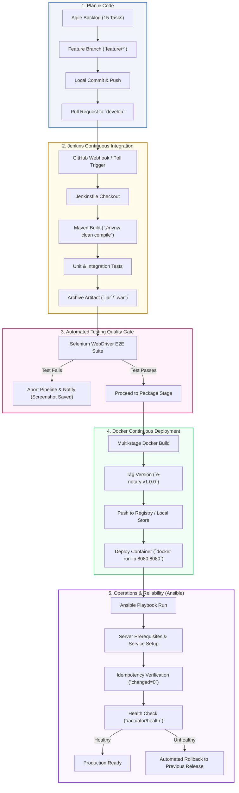

# Stage 2: Agile Planning and DevOps Workflow

| Metadata | Details |
| :--- | :--- |
| **Project Name** | Containerized E-Notary Appointment System |
| **Coursework Reference** | `docs/devops-project-guidelines.ods` (Row 39) |
| **Student** | Aryan Racha (Roll No: `23102C0055`) |
| **Deliverables Covered** | User Stories, Acceptance Criteria, Product Backlog, 15-Task Kanban/Sprint Plan, Definition of Done, DevOps Lifecycle Diagram |

---

## 1. User Stories & Acceptance Criteria

To structure feature development, user stories are written in standard agile format: *“As a [role], I want to [action] so that [benefit]”*, with verifiable Given-When-Then acceptance criteria.

### US-01: User Registration and Authentication
- **Story:** As a **Client**, I want to create an account with my email, full name, phone number, and a secure password so that I can schedule and track notarial appointments.
- **Acceptance Criteria:**
  - *Given* a new user is on the registration page,
  - *When* they provide valid credentials and submit,
  - *Then* an account is created with encrypted credentials, and they are redirected to login.
  - *Given* an email that already exists in the system,
  - *When* the user attempts registration,
  - *Then* the system rejects it with an error banner: *"Email already registered"*.

### US-02: Availability and Slot Browsing
- **Story:** As a **Client**, I want to browse available time slots for a selected notary and date so that I can pick a convenient time for my notarization.
- **Acceptance Criteria:**
  - *Given* a notary has published availability for a date,
  - *When* the client selects the notary and date on the calendar,
  - *Then* all unbooked 30-minute slots are displayed with clear start and end times.
  - *Given* a slot that has already been booked or locked,
  - *When* the client views the date,
  - *Then* that slot is either hidden or marked as disabled.

### US-03: Booking Request Submission
- **Story:** As an authenticated **Client**, I want to book an available slot by entering the document type (e.g., Affidavit, Property Deed, Power of Attorney) and a brief description so that the notary knows what service is required.
- **Acceptance Criteria:**
  - *Given* the client has selected an available slot,
  - *When* they choose the document type and click *"Submit Booking Request"*,
  - *Then* the slot status transitions from `AVAILABLE` to `BOOKED`, an appointment record is created in `REQUESTED` state, and an alphanumeric reference code (e.g., `ENOT-2026-A1B2`) is displayed.

### US-04: Notary Booking Review & Confirmation
- **Story:** As a **Certified Notary**, I want to view pending appointment requests and either confirm or reject them so that I can control my schedule.
- **Acceptance Criteria:**
  - *Given* an appointment in `REQUESTED` state,
  - *When* the notary clicks *"Confirm"*,
  - *Then* the status updates to `CONFIRMED`, and the client's dashboard reflects the confirmation.

### US-05: Appointment Cancellation & Slot Release
- **Story:** As a **Client** or **Notary**, I want to cancel an existing appointment with an explanation so that the slot is immediately freed up for other clients.
- **Acceptance Criteria:**
  - *Given* an active appointment (`REQUESTED` or `CONFIRMED`),
  - *When* the user clicks *"Cancel Appointment"*, supplies a mandatory cancellation reason, and submits,
  - *Then* the appointment status updates to `CANCELLED`, and the corresponding slot is automatically reset to `AVAILABLE`.

### US-06: Public Status Tracking
- **Story:** As an **Applicant**, I want to track the status of my appointment by entering my booking reference code so that I can check its progress without logging in.
- **Acceptance Criteria:**
  - *Given* a valid reference code,
  - *When* the user submits it on the tracking page,
  - *Then* the system displays the appointment date, notary name, document type, and current status.

---

## 2. 15-Task Product Backlog & Sprint Plan

The project is split into two targeted sprints of work across the 15 tasks identified in Stage 1:

### Sprint 1: Core Foundation & Booking Flow (Tasks 01 to 09)
*Focus: Data model, authentication, notary slot availability, and atomic booking creation.*

### Sprint 2: Management, Cancellation, Tracking & Operations (Tasks 10 to 15)
*Focus: Dashboards, review workflows, cancellation with slot reactivation, tracking, and operational monitoring.*

| Task ID | Task Title | Sprint | Priority | Story Points | Assignee | State |
| :--- | :--- | :--- | :--- | :--- | :--- | :--- |
| **TASK-01** | JPA Domain Entities (`User`, `Notary`, `Slot`, `Appointment`) | Sprint 1 | P0 | 3 | Aryan Racha | Ready |
| **TASK-02** | Spring Data Repositories & In-Memory Config | Sprint 1 | P0 | 2 | Aryan Racha | Ready |
| **TASK-03** | User Registration & BCrypt Password Hashing | Sprint 1 | P0 | 3 | Aryan Racha | Ready |
| **TASK-04** | Thymeleaf Auth Views (Sign-up, Login, Logout) | Sprint 1 | P1 | 3 | Aryan Racha | Ready |
| **TASK-05** | Notary Availability Management Service | Sprint 1 | P0 | 3 | Aryan Racha | Ready |
| **TASK-06** | Interactive Slot Browsing View | Sprint 1 | P0 | 3 | Aryan Racha | Ready |
| **TASK-07** | Booking Request Form & Payload Validation | Sprint 1 | P0 | 5 | Aryan Racha | Ready |
| **TASK-08** | Concurrency Control (Zero Double-Booking Guard) | Sprint 1 | P0 | 5 | Aryan Racha | Ready |
| **TASK-09** | Reference Code Generator (`ENOT-YYYY-XXXX`) | Sprint 1 | P1 | 2 | Aryan Racha | Ready |
| **TASK-10** | Client Appointments Dashboard | Sprint 2 | P1 | 3 | Aryan Racha | Backlog |
| **TASK-11** | Notary Decision & Review Dashboard | Sprint 2 | P0 | 3 | Aryan Racha | Backlog |
| **TASK-12** | Cancellation Form with Mandatory Reason | Sprint 2 | P0 | 3 | Aryan Racha | Backlog |
| **TASK-13** | Dynamic Slot Re-activation Logic | Sprint 2 | P0 | 3 | Aryan Racha | Backlog |
| **TASK-14** | Public Status Tracker by Reference Code | Sprint 2 | P1 | 2 | Aryan Racha | Backlog |
| **TASK-15** | Actuator Health Check (`/actuator/health`) | Sprint 2 | P0 | 2 | Aryan Racha | Backlog |

---

## 3. 15-Task Kanban Board Visual

```
+-------------------------------------------------------------------------------------------------------------+
|                                             KANBAN BOARD                                                    |
+---------------------+---------------------+---------------------+---------------------+---------------------+
|       BACKLOG       |    READY FOR DEV    |     IN PROGRESS     |     TEST & REVIEW   |        DONE         |
+---------------------+---------------------+---------------------+---------------------+---------------------+
| TASK-10 (Client     | TASK-01 (Entities)  |                     |                     |                     |
|         Dashboard)  | TASK-02 (Repos)     |                     |                     |                     |
| TASK-11 (Notary     | TASK-03 (Auth Logic)|                     |                     |                     |
|         Review)     | TASK-04 (Auth UI)   |                     |                     |                     |
| TASK-12 (Cancel Form| TASK-05 (Slot Mgmt) |                     |                     |                     |
| TASK-13 (Slot Reset)| TASK-06 (Slot Grid) |                     |                     |                     |
| TASK-14 (Tracker)   | TASK-07 (Booking UI)|                     |                     |                     |
| TASK-15 (Actuator)  | TASK-08 (Collision) |                     |                     |                     |
|                     | TASK-09 (Ref Gen)   |                     |                     |                     |
+---------------------+---------------------+---------------------+---------------------+---------------------+
```

---

## 4. Definition of Done (DoD)

To ensure academic and engineering quality, a task is only classified as **Done** when all the following criteria are satisfied:

1. **Code Completeness:** Clean Java implementation following Spring conventions (separation of Controller, Service, and Repository layers).
2. **Deterministic Tests:** Unit or integration tests pass locally via `./mvnw test` with zero assertions failing.
3. **No Regressions:** All existing functional journeys continue to execute cleanly.
4. **Git Branching Compliance:** Developed on a dedicated `feature/*` branch, reviewed, and merged into `develop`/`main` with atomic, descriptive commit messages.
5. **Quality Gate:** Code compiles cleanly with zero Maven warnings/errors and passes Jenkins pipeline checks.
6. **Documentation Updated:** Rationale, API endpoints, or config parameters recorded in the corresponding `docs/` deliverable file.

---

## 5. End-to-End DevOps Lifecycle Workflow

The following diagram maps out our continuous delivery lifecycle from developer commit to automated configuration management and rollback:



---

## 6. Verification & Sign-off

- [x] Comprehensive User Stories with Given-When-Then Acceptance Criteria defined.
- [x] Product Backlog structured across Sprint 1 and Sprint 2 with priorities and story points.
- [x] Explicit 15-task Kanban board visual defined.
- [x] Strict 6-point Definition of Done (DoD) established.
- [x] End-to-end DevOps Lifecycle diagram created covering Code, Build, Test, Docker CD, and Ansible Provisioning.
- [x] Approved for Stage 3: Requirements, Architecture, and Technology Setup.
