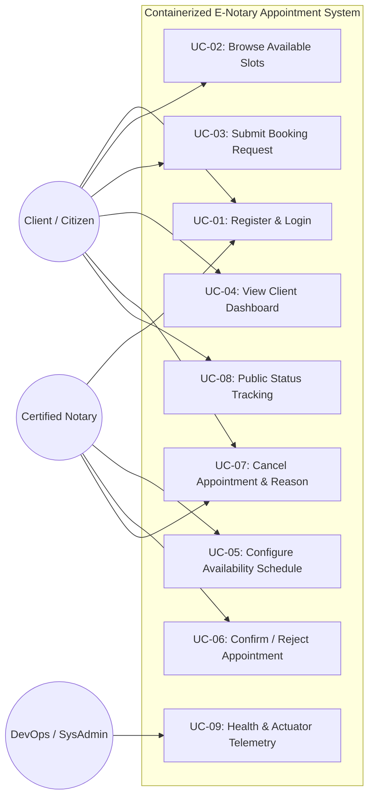
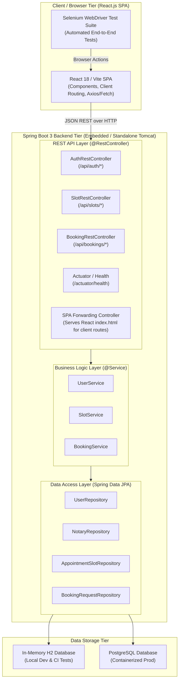
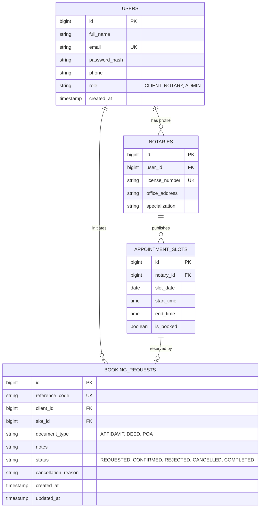

# Stage 3: Requirements, Architecture and Technology Setup

| Metadata | Details |
| :--- | :--- |
| **Project Name** | Containerized E-Notary Appointment System |
| **Coursework Reference** | `docs/devops-project-guidelines.ods` (Row 39) |
| **Student** | Aryan Racha (Roll No: `23102C0055`) |
| **Deliverables Covered** | SRS Summary, Use-Case Diagram, Architecture Diagram, Data Model / API List, Working Local Setup |

---

## 1. Software Requirements Specification (SRS) Summary

### 1.1 Functional Requirements (FR)

- **FR-01 (User Registration & Authentication):** The system shall allow Clients and Notaries to register with full name, email, phone number, and password. Passwords must be hashed using BCrypt. Roles (`CLIENT`, `NOTARY`, `ADMIN`) must restrict access to role-specific dashboards.
- **FR-02 (Availability & Slot Configuration):** The system shall allow Notaries to define their available hours and automatically generate discrete 30-minute time slots for specified dates.
- **FR-03 (Slot Browsing & Filtering):** The system shall allow Clients to view available slots filtered by Notary and Date. Slots already booked or locked must not be selectable.
- **FR-04 (Appointment Booking & Reference Generation):** The system shall allow authenticated Clients to reserve an available slot, specify the document type (e.g., *Affidavit*, *Power of Attorney*, *Property Deed*), and attach notes. Upon submission, an alphanumeric reference code (`ENOT-YYYY-XXXX`) is assigned.
- **FR-05 (Booking Confirmation Workflow):** The system shall provide Notaries with a dashboard to review incoming appointment requests and transition them from `REQUESTED` to `CONFIRMED` or `REJECTED`.
- **FR-06 (Appointment Cancellation & Automatic Slot Reactivation):** The system shall permit either party to cancel a scheduled appointment with a mandatory cancellation reason. Cancellation automatically reverts the associated slot back to `AVAILABLE`.
- **FR-07 (Public Status Tracking):** The system shall provide an unauthenticated public tracking page where users can input their booking reference code to view current appointment status and details.

### 1.2 Non-Functional Requirements (NFR)

- **NFR-01 (Transactional Integrity & Concurrency):** Slot booking must be executed within an ACID transaction with isolation to guarantee zero double-booking even under concurrent requests.
- **NFR-02 (Portability & Containerization):** The application must package into a single, self-contained executable JAR/WAR deployable to standalone Tomcat, embedded Tomcat, or a minimal Docker container.
- **NFR-03 (Testability):** All user journeys must expose standard HTML identifiers (`id`, `name`, `data-testid`) to support automated end-to-end testing via Selenium WebDriver.
- **NFR-04 (Observability):** Health check and telemetry endpoints must be exposed under `/actuator/health` for monitoring by Jenkins, Docker, and Ansible.
- **NFR-05 (Performance):** Page render times must not exceed 200ms on a standard local environment with in-memory H2 database.

---

## 2. Use Case Model & Diagram



---

## 3. Application Architecture Diagram

The system employs a decoupled **Client-Server Single Page Application (SPA)** architecture, packaged into a single deployable artifact via Maven:



---

## 4. Domain Data Model & Entity Relationship (ER) Diagram



---

## 5. REST API & SPA Endpoints Specification

### 5.1 Backend REST API Endpoints (`/api/*`)
| HTTP Method | Route / Endpoint | Access Level | Description | Request Body / Query Params | Response JSON |
| :--- | :--- | :--- | :--- | :--- | :--- |
| `POST` | `/api/auth/register` | Public | Register client or notary | `{ fullName, email, password, role, phone, licenseNumber, officeAddress, specialization }` | `{ success: true, user: {...} }` |
| `POST` | `/api/auth/login` | Public | Authenticate user | `{ email, password }` | `{ success: true, user: {...} }` |
| `GET` | `/api/auth/current` | Public / Auth | Get currently logged-in user | None (Session/Header) | `{ user: {...} }` |
| `POST` | `/api/auth/logout` | Auth | Invalidate session | None | `{ success: true }` |
| `GET` | `/api/notaries` | Public | List all certified notaries | None | `[ { id, fullName, licenseNumber, ... } ]` |
| `GET` | `/api/slots` | Public | Available slots for notary & date | `?notaryId=&date=` | `[ { id, slotDate, startTime, endTime, isBooked } ]` |
| `POST` | `/api/slots/generate`| Notary | Generate availability slots | `{ notaryId, date, startTime, endTime }` | `[ { id, ... } ]` |
| `POST` | `/api/bookings` | Client | Submit booking request | `{ slotId, documentType, notes }` | `{ referenceCode, status, ... }` |
| `GET` | `/api/bookings/track/{code}` | Public | Public appointment tracking | Path variable `code` | `{ referenceCode, status, notary, slot, ... }` |
| `GET` | `/api/bookings/my` | Client | Client's booking history | None (Session) | `[ { id, referenceCode, status, ... } ]` |
| `GET` | `/api/bookings/notary` | Notary | Notary's incoming bookings | None (Session) | `[ { id, referenceCode, status, ... } ]` |
| `POST` | `/api/bookings/{id}/confirm` | Notary | Confirm an appointment | Path variable `id` | `{ success: true, status: "CONFIRMED" }` |
| `POST` | `/api/bookings/{id}/cancel` | Client/Notary | Cancel with reason | `{ cancellationReason }` | `{ success: true, status: "CANCELLED" }` |
| `GET` | `/actuator/health` | Public | Health status check | None | `{ "status": "UP" }` |

### 5.2 React Single Page Application (SPA) Routes
- `/` — Landing page with hero banner, service overview, and quick links
- `/login` — Sign-in interface
- `/register` — Account registration with client/notary toggle
- `/slots` — Interactive notary slot calendar and availability grid
- `/bookings/new` — Booking request submission view
- `/bookings/track` — Public status tracking search view
- `/dashboard/client` — Client appointment management dashboard
- `/dashboard/notary` — Notary appointment review and slot management dashboard

---

## 6. Technology Stack Decision Matrix

| Layer | Selection | Justification |
| :--- | :--- | :--- |
| **Language** | Java 17 LTS | Modern LTS release with high stability, standard in enterprise and academic curricula. |
| **Framework** | Spring Boot 3.2.x | Rapid development, built-in production metrics (`Actuator`), seamless database ORM and REST controllers. |
| **Frontend SPA** | React 18 + Vite | Modern reactive component architecture, fast state updates, and TypeScript support. |
| **Build & Packaging** | Apache Maven 3.9+ (`frontend-maven-plugin`) | Standardized lifecycle; builds React SPA and bundles production bundle into Spring Boot JAR/WAR for single-artifact deployment. |
| **Persistence** | Spring Data JPA + Hibernate | Clean repository pattern with automatic query derivation and schema generation. |
| **Testing** | JUnit 5, MockMvc, Selenium WebDriver | Comprehensive unit, integration, and UI testing running natively via `./mvnw test`. |

---

## 7. Working Local Setup Instructions

### Prerequisites
- Java 17+ (`java -version`)
- Maven 3.9+ or bundled Maven Wrapper (`./mvnw`)

### Build & Run Commands
```bash
# 1. Clean and compile the project
./mvnw clean compile

# 2. Run unit and integration tests
./mvnw test

# 3. Package the executable JAR
./mvnw clean package -DskipTests

# 4. Run the application locally
./mvnw spring-boot:run
```

Once started, the application is accessible at:
- **Web Portal:** `http://localhost:8080/`
- **H2 In-Memory Console:** `http://localhost:8080/h2-console`
- **Health Check Endpoint:** `http://localhost:8080/actuator/health`
