# Stage 6: MVP Completion and Git Collaboration

| Metadata | Details |
| :--- | :--- |
| **Project Name** | Containerized E-Notary Appointment System |
| **Coursework Reference** | `docs/devops-project-guidelines.ods` (Row 39) |
| **Student** | Aryan Racha (Roll No: `23102C0055`) |
| **Feature Branches** | `feature/appointment-booking`, `feature/conflict-demo` |
| **Release Tag** | `v1.0.0-mvp` |
| **Deliverables Covered** | Functional MVP (All 6 Modules), Resolved Merge Conflict, Tagged Version, Updated Backlog |

---

## 1. Functional MVP Implementation (All 6 Modules)

The complete MVP for the **Containerized E-Notary Appointment System** is operational and verified across all 6 mandated modules:

```mermaid
flowchart LR
    M1["1. User Registration<br/>(Client & Notary)"] --> M2["2. Availability & Slots<br/>(30-min Windows)"]
    M2 --> M3["3. Booking Request<br/>(Ref: ENOT-YYYY-XXXX)"]
    M3 --> M4["4. Notary Confirmation<br/>(Review & Approval)"]
    M4 --> M5["5. Self-Service Cancel<br/>(Slot Reactivation)"]
    M5 --> M6["6. Public Status Tracker<br/>(Real-Time Audit)"]

    style M1 fill:#eff6ff,stroke:#3b82f6
    style M2 fill:#f0fdf4,stroke:#16a34a
    style M3 fill:#fefce8,stroke:#ca8a04
    style M4 fill:#faf5ff,stroke:#9333ea
    style M5 fill:#fff1f2,stroke:#e11d48
    style M6 fill:#ecfeff,stroke:#0891b2
```



### Module Breakdown

| Module | Core Logic & Components | Endpoints & Views |
| :--- | :--- | :--- |
| **1. User Registration & Auth** | `UserService`, `PasswordUtil` (salted SHA-256), `UserRepository`, `NotaryRepository`. | `POST /api/auth/register`<br/>`POST /api/auth/login`<br/>`POST /api/auth/logout`<br/>`/register`, `/login` |
| **2. Availability / Slot View** | `SlotService` generates 30-min discrete time slots; prevents schedule overlap; filters unbooked slots. | `GET /api/slots?notaryId=&date=`<br/>`POST /api/slots/generate`<br/>`/slots` |
| **3. Booking Request** | `BookingService` enforces zero double-booking; generates alphanumeric reference codes (e.g. `ENOT-2026-X9Y2`). | `POST /api/bookings`<br/>`/bookings/new` |
| **4. Notary Confirmation** | Notary review dashboard allows notaries to inspect client requests, accept (`CONFIRMED`), or reject. | `POST /api/bookings/{id}/confirm`<br/>`/dashboard/notary` |
| **5. Cancellation & Slot Release** | Either party can cancel with mandatory reason. **Dynamic Reactivation:** slot status flips back to `AVAILABLE`. | `POST /api/bookings/{id}/cancel`<br/>`/dashboard/client` |
| **6. Public Status Tracking** | Public lookup by reference code showing applicant name, notary, date/time, and live status. | `GET /api/bookings/track/{code}`<br/>`/bookings/track` |

---

## 2. Git Collaboration & Merge Conflict Resolution

To satisfy the coursework grading requirement for **Git collaboration and conflict resolution**, an intentional merge conflict was created on `src/main/resources/application.properties` and resolved.

### Step 1: Divergent Changes Across Branches
- On `develop` (Commit `fd9d8cf`):
  ```properties
  server.port=${SERVER_PORT:8080} # Standard HTTP listener port for production and Jenkins CI
  ```
- On `feature/conflict-demo` (Commit `44e187e`):
  ```properties
  server.port=${SERVER_PORT:9000} # Alternate developer staging port for collision test
  ```

### Step 2: Triggering the Merge Conflict
Executing `git merge feature/conflict-demo` on `develop` halted automatic merging:

```text
Auto-merging src/main/resources/application.properties
CONFLICT (content): Merge conflict in src/main/resources/application.properties
Automatic merge failed; fix conflicts and then commit the result.
```

### Step 3: Conflict Markers (`git diff`)
```properties
<<<<<<< HEAD
server.port=${SERVER_PORT:8080} # Standard HTTP listener port for production and Jenkins CI
=======
server.port=${SERVER_PORT:9000} # Alternate developer staging port for collision test
>>>>>>> feature/conflict-demo
```

### Step 4: Resolution & Final Commit
The conflict was resolved by standardizing on port `8080` while retaining runtime environment override support:
```properties
server.port=${SERVER_PORT:8080}
```

Staged and finalized with merge commit `0bd4aaf`:
```bash
git add src/main/resources/application.properties
git commit -m "Merge branch 'feature/conflict-demo' into develop: resolved port conflict in application.properties"
```

---

## 3. Git Graph History

```text
*   0bd4aaf (HEAD -> develop, tag: v1.0.0-mvp, main) Merge branch 'feature/conflict-demo' into develop: resolved port conflict in application.properties
|\  
| * 44e187e (feature/conflict-demo) config: modify staging port to 9000 on feature branch
* | fd9d8cf config: clarify standard production listener port in application.properties
|/  
*   e73e996 Merge pull request #2 from feature/appointment-booking: Complete 6 MVP Modules
|\  
| * 3b3749c (feature/appointment-booking) feat: complete remaining MVP modules (slot availability, booking requests, confirmation, cancellation, and tracking)
|/  
* f75921f feat: integrate React.js SPA frontend and Spring Boot REST API architecture
* 8ef5673 docs: add Stage 5 feature development and branching deliverable
*   5f73370 Merge pull request #1 from feature/user-auth: User Registration & Authentication
|\  
| * 457b972 (feature/user-auth) test: add unit and integration test suite for user authentication
| * 0a07fc8 feat: implement auth web controller and Thymeleaf register/login templates
| * b3f5ebb feat: implement user registration and authentication service
| * bd5d446 feat: add user, notary, and role domain models with JPA repositories
|/  
* 88900dd docs: record remote GitHub repository URL
* cb74e5f chore: initialize project skeleton with Spring Boot 3, Maven wrapper, and docs
```

---

## 4. Release Tagging: `v1.0.0-mvp`

The verified code on `develop` was merged to `main` and tagged with an annotated release:

```bash
git checkout main
git merge develop
git tag -a v1.0.0-mvp -m "v1.0.0-mvp: Complete functional MVP of Containerized E-Notary Appointment System"
```

Verification:
```bash
$ git tag -l -n3
v1.0.0-mvp      v1.0.0-mvp: Complete functional MVP of Containerized E-Notary Appointment System
```

---

## 5. Automated Regression Test Suite Evidence

All 35 unit and integration tests executed cleanly via `./mvnw test` prior to release tagging:

```text
[INFO] -------------------------------------------------------
[INFO]  T E S T S
[INFO] -------------------------------------------------------
[INFO] Running com.enotary.controller.AuthControllerTest
[INFO] Tests run: 7, Failures: 0, Errors: 0, Skipped: 0
[INFO] Running com.enotary.controller.AuthRestControllerTest
[INFO] Tests run: 6, Failures: 0, Errors: 0, Skipped: 0
[INFO] Running com.enotary.controller.BookingRestControllerTest
[INFO] Tests run: 4, Failures: 0, Errors: 0, Skipped: 0
[INFO] Running com.enotary.service.SlotServiceTest
[INFO] Tests run: 3, Failures: 0, Errors: 0, Skipped: 0
[INFO] Running com.enotary.service.BookingServiceTest
[INFO] Tests run: 5, Failures: 0, Errors: 0, Skipped: 0
[INFO] Running com.enotary.service.UserServiceTest
[INFO] Tests run: 7, Failures: 0, Errors: 0, Skipped: 0
[INFO] Running com.enotary.ENotaryApplicationTests
[INFO] Tests run: 3, Failures: 0, Errors: 0, Skipped: 0
[INFO] 
[INFO] Results:
[INFO] 
[INFO] Tests run: 35, Failures: 0, Errors: 0, Skipped: 0
[INFO] 
[INFO] ------------------------------------------------------------------------
[INFO] BUILD SUCCESS
[INFO] ------------------------------------------------------------------------
[INFO] Total time:  10.184 s
```

---

## 6. Updated 15-Task Product Backlog Status

| Task ID | Task Title | Sprint | Priority | Status |
| :--- | :--- | :--- | :--- | :--- |
| **TASK-01** | JPA Domain Entities (`User`, `Notary`, `Role`, `Slot`, `Booking`) | Sprint 1 | P0 | **DONE** |
| **TASK-02** | Spring Data Repositories & In-Memory Config | Sprint 1 | P0 | **DONE** |
| **TASK-03** | User Registration & BCrypt / Salted SHA-256 Hashing | Sprint 1 | P0 | **DONE** |
| **TASK-04** | Auth Views & REST Authentication Controllers | Sprint 1 | P1 | **DONE** |
| **TASK-05** | Notary Availability Management Service | Sprint 1 | P0 | **DONE** |
| **TASK-06** | Interactive Slot Browsing View | Sprint 1 | P0 | **DONE** |
| **TASK-07** | Booking Request Form & Payload Validation | Sprint 1 | P0 | **DONE** |
| **TASK-08** | Concurrency Control (Zero Double-Booking Guard) | Sprint 1 | P0 | **DONE** |
| **TASK-09** | Reference Code Generator (`ENOT-YYYY-XXXX`) | Sprint 1 | P1 | **DONE** |
| **TASK-10** | Client Appointments Dashboard | Sprint 2 | P1 | **DONE** |
| **TASK-11** | Notary Decision & Review Dashboard | Sprint 2 | P0 | **DONE** |
| **TASK-12** | Cancellation Form with Mandatory Reason | Sprint 2 | P0 | **DONE** |
| **TASK-13** | Dynamic Slot Re-activation Logic | Sprint 2 | P0 | **DONE** |
| **TASK-14** | Public Status Tracker by Reference Code | Sprint 2 | P1 | **DONE** |
| **TASK-15** | Actuator Health Check (`/actuator/health`) | Sprint 2 | P0 | **DONE** |

---

## 7. Verification & Sign-off

- [x] All 6 core MVP modules implemented, tested, and operational.
- [x] Feature branch `feature/appointment-booking` created and merged via PR #2.
- [x] Merge conflict simulated on `feature/conflict-demo`, conflict markers recorded, and resolved.
- [x] Annotated release tag `v1.0.0-mvp` created on `main`.
- [x] All 15 Product Backlog tasks transitioned to **DONE**.
- [x] Ready for Stage 7: Jenkins CI Job Configuration.
